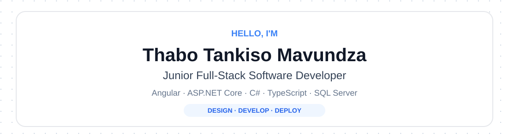

<div align="center">



<br />


<br />


</div>

## About Me

I'm a **Junior Full-Stack Software Developer** with **professional software development experience** and a **BSc in Information Technology**, majoring in Software Development.

I develop database-driven applications using **Angular, TypeScript, C#, ASP.NET Core Web APIs, Entity Framework Core, and SQL Server**. My work spans requirements analysis, frontend development, backend services, relational data modelling, authentication and authorization, API testing, and debugging.

I bring a strong software engineering foundation in **object-oriented programming, data structures and algorithms, systems analysis and design, database systems, and information security**. I enjoy learning new technologies and turning business requirements into maintainable software.

- **I build:** Responsive web applications, RESTful APIs, and role-based business systems.
- **I work with:** Angular, ASP.NET Core, EF Core, SQL Server, PostgreSQL, Git, and Azure DevOps.
- **I'm exploring:** Docker, CI/CD, Azure deployment, software architecture, and AI integration.
- **I'm open to:** Junior full-stack, backend, and software developer opportunities.

## Technical Skills

### Frontend

     

Angular Material · Reactive Forms · Routing · Guards · Interceptors · Responsive UI

### Backend & APIs

  

REST APIs · Entity Framework Core · LINQ · Dependency Injection · Role-Based Access Control · SignalR · SMTP

### Databases & Tools

     

GitHub · Visual Studio · VS Code · Swagger/OpenAPI · EF Core Migrations

### Programming Languages

C# · TypeScript · JavaScript · Java · Python · C++

## Software Engineering Foundations

| Area | Knowledge |
| --- | --- |
| **Programming & problem solving** | Object-Oriented Programming, Data Structures & Algorithms, Structured Programming |
| **Systems & software design** | Systems Analysis & Design, Requirements Analysis, SDLC, UI Design |
| **Databases** | Relational Database Design, SQL, Database Management Systems |
| **Security** | Information Security, Authentication, Authorization |
| **Computing fundamentals** | Operating Systems, Computer Networks, Discrete Mathematics |
| **Data & decision making** | Data Analytics, Statistics, Decision Support Systems |

## Featured Projects

### BrightSmile Dental — Full-Stack Appointment Platform

A portfolio application built with **Angular, ASP.NET Core Web API, EF Core, and Supabase PostgreSQL**, with a role-based architecture for **Admin, Dentist, and Patient** users.

**Implemented foundations:** Registration and login, JWT authentication, role-based authorization, password-reset endpoints, database models and migrations, and frontend deployment.

**In progress:** Expanding the role-specific dashboards and appointment workflows.

[**Live frontend**](https://brightsmiledentalfrontend.netlify.app) · [**Frontend repository**](https://github.com/AriesMaster/BrightSmileDentalFrontEnd) · [**Backend repository**](https://github.com/AriesMaster/BrightSmileDentalBackEnd)

### SceniSchedule — Support Agent Scheduling System

Professional full-stack application designed to replace manual scheduling workflows with structured scheduling, approval, and notification processes.

**Technologies:** Angular · ASP.NET Core · C# · SQL Server · EF Core · SignalR

**Engineering contributions:** Scheduling management, JWT authentication, role-based permissions, change requests and approvals, real-time notification counts, conflict handling, and email/calendar integrations.

*Professional project; source code is not linked publicly.*

## Currently Learning & Building

```text
Docker & containerization  →  Package full-stack applications
CI/CD pipelines            →  Automate builds, tests, and deployments
Microsoft Azure            →  Develop cloud deployment experience
Software architecture      →  Improve design and maintainability
AI & MCP                   →  Explore AI-enabled application workflows
```

## GitHub Activity

<div align="center">


</div>

